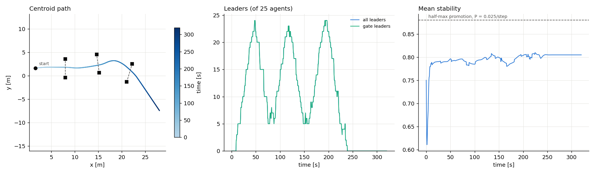

# emergent-leaders

Flocking with emergent, goal-directed leaders. This is the model behind the
`random_walk/simulation.py` code in the `mas_random_walk` repository,
reimplemented as small, tested modules, plus gates that the swarm passes
through. All default parameters of the reference model match that code (see
`params.py`).



## Model

N unicycle agents, each with position $\mathbf{x}_i$ and heading $\theta_i$.
Agent $i$ senses the neighbours $\mathcal{N}_i$ within `sense_range`, at distance
$d_{ij}$ and body-frame bearing $\phi_{ij}$.

### Motion (`motion.py`)

A virtual force, expressed in agent $i$'s body frame:

$$\mathbf{f}_i = \alpha\,\mathbf{p}_i + \beta\,\mathbf{h}_i + G\,\gamma_i\,\mathbf{g}_i$$

- **Proximal control:**
  $\mathbf{p}_i = \sum_{j\in\mathcal{N}_i} F(d_{ij})\,[\cos\phi_{ij}, \sin\phi_{ij}]$ with
  $F(d) = -\varepsilon\,(2\sigma_i^4/d^5 - \sigma_i^2/d^3)$. The equilibrium spacing is
  $d_\text{des} = \sqrt2\,\sigma_i$: neighbours attract beyond it and repel inside it.
  Leaders use a smaller $\sigma$ (0.6 instead of 0.7).
- **Heading alignment:** $\mathbf{h}_i$ is the unnormalised sum of all agents'
  heading unit vectors, rotated into $i$'s frame, as in the reference.
  `local_alignment=True` (`--local-alignment` on the command line) sums only over
  $i$ and its neighbours in $\mathcal{N}_i$.
- **Goal direction:** $\mathbf{g}_i = [\cos(\psi_i-\theta_i), \sin(\psi_i-\theta_i)]$, where
  $\psi_i$ is the leader's goal heading. $\gamma_i = 1$ for leaders and 0 for followers.

The force maps to speed commands, which are integrated with forward Euler:

$$u_i = \operatorname{clip}(k_1 f_x + u_c,\ 0,\ u_\max),\qquad
\omega_i = \operatorname{clip}(k_2 f_y,\ -\omega_\max,\ \omega_\max)$$

### Leadership emergence (`leadership.py`)

Each agent computes a local **stability** from how evenly its neighbours are
spaced and how well they are aligned:

$$s_i = w_d\Big(1 - \tfrac{1}{|\mathcal{N}_i|}\textstyle\sum_j \tfrac{(d_{ij}-d_\text{des})^2}{d_\text{des}^2}\Big)
      + w_h\,\frac{\big|\sum_{j\in\mathcal{N}_i\cup\{i\}} e^{\mathrm{i}\theta_j}\big|}{|\mathcal{N}_i|+1}$$

At every step, a follower is promoted to leader with probability

$$P(s) = \frac{p_\max}{1 + e^{-k(s - s_0)}},\qquad s_0 = b - \ln(1/p_\max)/k.$$

Promotion can be restricted with `leader_type`: `inner` agents have a
neighbour in each of their four body-frame quadrants, and `outer` agents do
not. `free` allows any agent.

A new leader gets a **leg** from the goal model: a goal heading $\psi_i$ and a
path length. When it has travelled that length, it gets the next leg. After
`legs_per_tenure` legs it is demoted back to follower.

### Goal directions (`goals.py`)

A `GoalModel` assigns `(leg_lengths, goal_headings)` whenever an agent is
promoted or finishes a leg.

- `RandomWalkGoal(walk)`: the reference's random walks. Leg lengths come from a
  discretised Lévy-stable pdf, clipped to [4, 12] m. Headings are global and
  drawn from a wrapped Cauchy distribution centred on 0.

  | walk | stability α | ρ |
  |---|---|---|
  | `brown` | 2 | 0 |
  | `levy` | 1 | 0 |
  | `correlated` | 2 | 0.7 |

- `FixedGoal(heading)`: every leg points the same way.

Pass `explore=False` (`--no-explore`) to switch off these stability-driven
random-walk leaders, so that only gates create leaders.

### Gates (`gates.py`)

A gate is two posts `width` apart, centred on $\mathbf{c}$, with a passing
direction. The posts are solid discs of radius `post_radius` (0.15 m): an
agent that would end a step inside one is pushed back onto its edge. Agents do
not sense posts as obstacles, so they bump into them and slide off.

- **Sensing:** an agent senses a post perfectly when it is within
  `gate_sense_range` (4 m). Its **target** depends on how many posts of the
  gate it senses:
  - both posts: the gate centre, if the centre is in front of it, i.e. within
    `gate_front_half_angle` (90°) of its heading;
  - one post: that post, if it is in front. Closing in on it brings the other
    post into range, and the target moves to the centre.

  With both posts sensed and the centre behind, the agent is through (or
  beside) the gate and has no target. An agent with targets at two gates aims
  for the nearer one: the gate it is about to pass, and, once that gate's
  centre is behind it, the next one.
- **Gate leaders:** any agent with a gate target becomes a leader, whatever its
  stability. Its goal heading $\psi_i$ points at the target and is updated
  every step. It is demoted as soon as it has no target in front of it,
  typically right after passing through. That way it never turns back. A gate
  target overrides a random-walk leader's current leg.
- **Pausing exploration (optional, off by default):** with
  `pause_exploration_at_gates=True` (`--pause-exploration HOLD_OFF`), random-walk
  leaders step down and none are promoted while any agent has a gate target,
  and for `exploration_hold_off` seconds after the last one is lost.
- **Passages:** an agent passes a gate when it crosses the line between the
  posts in the passing direction. `Simulation.gate_pass_time` records the time
  of each agent's first passage through each gate.

**Course rules.** Courses are assumed to keep the next gate in view: while the
swarm passes a gate, some agent already senses the next one. `Simulation`
refuses a course unless:

- a post of each next gate lies within `gate_sense_range` of the point
  `gate_lookahead` (3.5 m) straight past the current gate's centre. That's how
  far the swarm's front reaches past a gate before its last agent crosses:
  3.5–4.3 m for 25 agents;
- `gate_sense_range` exceeds half the gate width, so that both posts can be
  sensed at all;
- posts of non-consecutive gates are more than twice `gate_sense_range` apart,
  so that no agent senses a gate out of order.

Pass `check_course=False` (`--no-course-check`) to run a course that breaks
these rules.

`Simulation.perceive_gates()` returns what each agent aims for; subclasses
override it to replace the perfect sensing (as
[`vision_leaders`](../vision_leaders/) does with cameras).
`gate_targets(..., visible=mask)` applies the rule to only the posts a mask
marks as visible.

`Simulation.next_gate_in_view()` reports, for each gate, whether some agent
did aim at the next gate before the last agent was through.

`slalom_course(n_gates, spacing, offset, width)` builds a course along +x with
alternating lateral offsets; each gate faces away from the previous one. Its
default 7 m spacing is the largest the default 4 m range allows.
`max_slalom_spacing(gate_sense_range, gate_lookahead, n_gates)` finds the
largest spacing for other ranges, and `run.py` uses it unless
`--gate-spacing` is given:

| gate range | 3 m | 4 m | 5 m | 6 m | 8 m |
|---|---|---|---|---|---|
| largest spacing, 1 m offsets | 6 m | 7 m | 8 m | 9 m | 11 m |
| largest offset (0.5 m steps) | 1 m | 1.5 m | 2 m | 2.5 m | 3.5 m |

`winding_course(turns, spacing, start, width)` places each gate `spacing`
from the previous one, turned by the next angle in `turns`, and faces it
along the new direction. `random_turns(n_gates, max_turn, rng)` draws the
turns uniformly and redraws until the course doesn't fold back on itself.
With `--course winding`, `run.py` draws turns up to `--max-turn` (default
90°) from `--seed`. `max_spacing(build, gate_sense_range, gate_lookahead)`
finds the largest spacing for any course builder. At the default 4 m range, a
single turn allows:

| turn | 0° | 15–30° | 45° | 60° | 75° | 90° |
|---|---|---|---|---|---|---|
| largest spacing | 6.5 m | 7 m | 6 m | 5.5 m | 4.5 m | 3.5 m |

Most random courses with turns up to 90° have no spacing that keeps the next
gate in view, so `run.py` asks for `--gate-spacing` and `--no-course-check`.

## Usage

```sh
pip install -e ".[dev]"

python -m emergent_leaders.run --walk levy --duration 500 --live          # interactive window
python -m emergent_leaders.run --walk correlated --seed 0 \
    --video run.mp4 --summary run.png                                    # MP4 replay + summary figure
python -m emergent_leaders.run --goal-heading 45 --summary goal45.png    # fixed goal direction
python -m emergent_leaders.run --local-alignment --live                  # align with neighbours only
python -m emergent_leaders.run --gates 5 --course winding --gate-spacing 7 --no-course-check \
    --start-heading 0 --sigma-leader 0.7 --seed 1 --live                 # random winding course
```

The gate examples, `videos/gates_example.mp4` (default 4 m range, gates 7 m
apart) and `videos/gates_range8.mp4` (`--gate-range 8 --duration 400`, gates
11 m apart):

```sh
python -m emergent_leaders.run --gates 3 --start-heading 0 --no-explore --sigma-leader 0.7 \
    --seed 0 --duration 320 --video videos/gates_example.mp4 --summary videos/gates_example_summary.png
```

`videos/gates_winding.mp4` is a five-gate winding course, gates 7 m apart,
with turns of 55°, 55°, 3° and −39°. 23 / 17 / 24 / 25 / 20 agents get
through, and the next gate was in view at every passage. The 55° turns break
the course rules at this spacing (the largest is about 6 m for 45°). Seeds
whose course has a turn of 75° or more usually lose the swarm at that turn.

```sh
python -m emergent_leaders.run --gates 5 --course winding --gate-spacing 7 --no-course-check \
    --start-heading 0 --no-explore --sigma-leader 0.7 --seed 5 --duration 440 \
    --video videos/gates_winding.mp4 --summary videos/gates_winding_summary.png
```

From Python:

```python
import numpy as np
from emergent_leaders import ModelParams, Simulation, grid_swarm, slalom_course
from emergent_leaders.visualize import plot_summary, render_video

params = ModelParams(sigma_leader=0.7)
start = grid_swarm(25, np.random.default_rng(0), heading=0.0)
sim = Simulation(params=params, state=start, gates=slalom_course(3), explore=False, seed=0)
history = sim.run(n_steps=6_400, record_every=10)
plot_summary(history, sim.params, "summary.png")
render_video(history, "run.mp4")
```

## Gate passing: first results

All results are for 25 agents on a three-gate slalom with 4 m wide gates and
1 m offsets, as far apart as the range allows, with solid posts and 10 seeds.
Unless stated otherwise, the swarm starts facing the course (0° ± 30°), with
`sigma_leader` = 0.7 and no explorers (`--no-explore`).

| gate range | spacing | `sigma_leader` | through gate 1 | gate 2 | gate 3 | runs with > 50% through all three | next gate in view |
|---|---|---|---|---|---|---|---|
| 8 m | 11 m | 0.7 | 99% | 99% | 93% | 10 / 10 | 20 / 20 |
| 8 m | 11 m | 0.6 (reference) | 97% | 38% | 17% | 2 / 10 | 14 / 14 |
| 6 m | 9 m | 0.7 | 100% | 98% | 88% | 10 / 10 | 20 / 20 |
| 5 m | 8 m | 0.7 | 98% | 95% | 79% | 9 / 10 | 19 / 20 |
| **4 m (default)** | **7 m** | **0.7** | **92%** | **90%** | **82%** | **10 / 10** | **20 / 20** |
| 4 m | 7 m | 0.6 (reference) | 73% | 24% | 8% | 1 / 10 | 11 / 11 |
| 3 m | 6 m | 0.7 | 82% | 86% | 71% | 10 / 10 | 20 / 20 |
| 3 m | 6 m | 0.6 (reference) | 56% | 54% | 8% | 0 / 10 | 16 / 16 |

"Next gate in view" counts the passages of gates 1 and 2 (when anyone passed)
in which some agent aimed at the next gate before the last agent was through.

On the default course (4 m range, 7 m spacing):

| start | explorers | through gate 1 | gate 2 | gate 3 | runs with > 50% through all three |
|---|---|---|---|---|---|
| facing the course | off | 92% | 90% | 82% | 10 / 10 |
| facing the course | on | 91% | 89% | 85% | 9 / 10 |
| random headings | off | 71% | 72% | 66% | 8 / 10 |
| random headings | on | 70% | 74% | 73% | 8 / 10 |

Findings:

- **Next gate in view:** it held in 138 of 140 passages across the first
  table; the two misses were near misses at 5 m. This rule is what makes short
  ranges work. Earlier, gates were 17 m apart and no agent sensed anything for
  about 9 m after a gate. The swarm drifted between gates, by 5–40° in heading
  at 4 m, and 3–6 m ranges got only 0–7 of 10 runs through. A first version of
  the check measured from anywhere within 3.5 m past the opening. It missed
  1 in 4 passages at 4–5 m, because the swarm's front is near the middle, not
  the corner closest to the next gate.
- **Single posts:** aiming at a lone post brings the swarm to the first gate
  even at short range. Before that rule, a 5 m range missed the first gate in
  about 2 of 3 runs. At 3–4 m, 8–18% of agents still pass beside gate 1.
- **Leader spacing:** gate leaders appear together on the side of the swarm
  facing the gate. With the reference's tighter leader spacing ($\sigma$ = 0.6)
  they pull together, and that lopsided squeeze turns the swarm. When they are
  all demoted after a gate, the formation relaxes and swings by 10–50°, so the
  swarm usually misses the next gate. This was diagnosed on the earlier
  17 m course. On the current courses, 0.6 gets most of the swarm through
  all three gates in at most 4 of 10 runs at any range from 3 to 8 m.
- **Most of the swarm leads:** even at 4 m, nearly every agent (up to 25)
  becomes a gate leader at each gate's peak, and about 13 on average while any
  agent has a gate target.
- **Explorers:** on this course, stability-driven random-walk leaders make no
  measurable difference, with or without a facing start. They raise the mean
  number of leaders from about 4–6 to about 10.
- **Gates further apart:** these courses break the course rules on purpose,
  with 2000 s per run. Random-walk leaders don't find gates the swarm has lost;
  they mostly lower its chance on the first approach:

  | spacing | no explorers | Lévy | Lévy, paused + 120 s | Brownian | Brownian, paused + 120 s |
  |---|---|---|---|---|---|
  | 7 m | 10 / 10 | 9 / 10 | 10 / 10 | 9 / 10 | 10 / 10 |
  | 12 m | 2 / 10 | 4 / 10 | 2 / 10 | 3 / 10 | 2 / 10 |
  | 17 m | 1 / 10 | 0 / 10 | 1 / 10 | 0 / 10 | 1 / 10 |
  | 25 m | 1 / 10 | 0 / 10 | 0 / 10 | 0 / 10 | 1 / 10 |

  The table counts runs that get most of the swarm through all three gates.
  Without explorers the swarm keeps going nearly straight, which on this
  slalom passes close to the next gate. Unpaused explorers pull it off that
  line, and their random walk (4–12 m legs in uniformly random directions)
  rarely brings it back within range. Pausing restores the straight-line
  chance but adds nothing beyond it. With no hold-off, exploration resumes
  before the swarm reaches the next gate and hurts at 12 m (1 of 10 runs);
  hold-offs of 120 s and 240 s give about the same results as no explorers.
- **Winding courses:** 10 random five-gate courses with turns up to 90°
  (`random_turns(5, 90°, default_rng(1000 + k), min_separation=1.5)`, so
  consecutive turns are below about 83°), 3000 s per run, course check off.
  "Gates reached" counts consecutive gates with most of the swarm through:

  | spacing | no explorers | Lévy | Lévy, paused + 120 s | Brownian | Brownian, paused + 120 s |
  |---|---|---|---|---|---|
  | 7 m | 2.5 (3 / 10) | 2.7 (2 / 10) | 2.5 (3 / 10) | 3.1 (3 / 10) | 2.5 (3 / 10) |
  | 12 m | 1.7 (0 / 10) | 1.5 (0 / 10) | 1.7 (0 / 10) | 1.8 (0 / 10) | 1.9 (0 / 10) |
  | 17 m | 1.4 (0 / 10) | 1.3 (0 / 10) | 1.4 (0 / 10) | 1.2 (0 / 10) | 1.7 (0 / 10) |

  Each cell is the mean number of gates reached, with the runs that reach all
  five in brackets. Turns decide the outcome. At 7 m without explorers, the
  swarm took every turn of 56° or less except a 45° one, and stopped at 5 of
  6 turns of 75° or more. A 90° turn keeps the next gate in view only up to
  3.5 m spacing. Unpaused Brownian explorers carried the swarm past a 56° and
  a 77° turn it had missed without them, but never past the 75–90° turns
  right after gate 1. In one run the swarm missed gate 2 but went through
  gates 3–5. With 10 runs, these differences are within noise. Paused
  explorers give the same result as none at 7 m.
- **Random start:** with random headings, 8 of 10 runs still get most of the
  swarm through, even without explorers, because gate 1 is only 4–8 m from the
  start. This setup doesn't test finding a gate that is far away or behind.
- **Solid posts:** on average 3–7 agents per run touch a post. They slide off
  within at most 12 s; none is trapped.
- **Sharp turns:** each slalom gate faces away from the previous one, so larger
  offsets give sharper turns, and the course rules limit the offset (see the
  table under Gates). At 8 m with a 3 m offset (9.5 m spacing), 10 of 10 runs
  get most of the swarm through, with 100% / 97% / 90% through. The largest
  offsets at short range are untested.

## Differences from the reference code

Without gates and with default parameters, the dynamics match the reference.
Over 1000 s with 25 agents, both implementations average about 12–13 leaders,
keep a swarm radius of about 3 m and reach a mean stability of about 0.81. A few
details differ:

- `n_agents` is the total number of agents. The reference's argument was the
  side length of the square starting grid.
- Run length is given in steps (`run(n_steps)`) or in seconds (`--duration`).
- `legs_per_tenure = 4` replaces "demote once 5 goal samples were drawn". These
  give the same behaviour: in the reference, the 5th sample is drawn as the 4th
  leg ends.
- In the reference, a leader that was demoted on the same step it finished a
  leg still drew a new sample, so its next tenure started with an inflated
  count. That no longer happens.
- Quadrant coverage is computed on the post-move configuration, the same as
  stability. The reference used the pre-move one, a difference of one time step.
- `local_alignment=True` is optional and off by default. With it, the swarm
  often splits under random-walk goals: in about 4–5 of 10 Lévy or Brownian runs
  of 600 s, and in 1 of 10 correlated runs.

Two behaviours are kept as they are in the reference but are worth knowing:

- With `brown`, every leg is exactly 4 m, because the Gaussian's 99th percentile
  (≈3.3) falls below the 4 m minimum.
- The `correlated` walk's headings are centred on global 0, not on the previous
  heading, so the swarm drifts towards +x.
