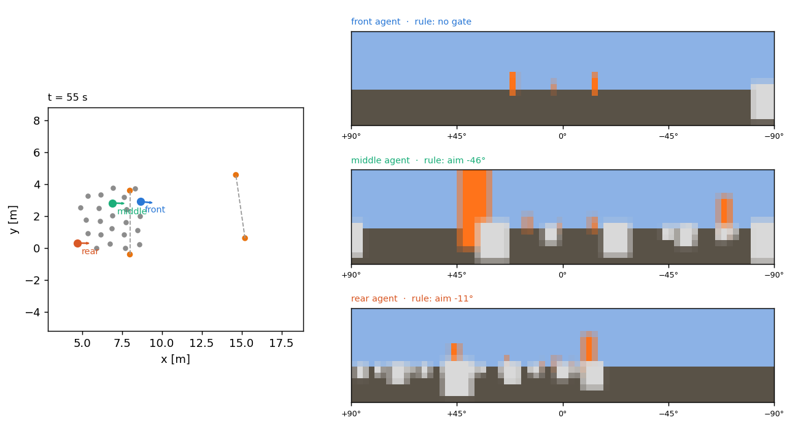

# vision-leaders

Gate perception from low-resolution cameras. Each agent of the
[`emergent_leaders`](../emergent_leaders/) swarm gets a forward camera, and a
small CNN maps its image to whether a gate is in view and the bearing to steer
along. The motion model, the leader bookkeeping and the gates are
`emergent_leaders`'; only the gate perception is replaced.

In `emergent_leaders` an agent becomes a gate leader when it senses a gate
post within 4 m in front of it, and aims at the gate centre (both posts
sensed) or at the lone post. Here the network decides both from the image.

## Camera (`camera.py`)

- 72 × 16 px, 8-bit RGB, 180° horizontal field of view; columns are equal
  steps in bearing (2.5° each), rows use the same angular step, heights
  project by perspective. The camera sits 0.2 m above the ground.
- Gate posts are orange cylinders, 1 m tall, of the motion model's post
  radius (0.15 m). Agents are grey cylinders, 0.25 m tall with radius 0.1 m
  (they are points in the motion model). Sky above the horizon, ground below.
- Pixels are area-sampled: an object fills the fraction of a pixel it covers,
  so a far post fades out instead of flickering. A post 4 m away is about
  2 px wide and 6 px tall.
- Objects are composited front to back, so nearer agents hide what is behind
  them. The posts stand above the agents, so their tops stay visible over the
  swarm. Rendering all 25 cameras takes about 6 ms per step.



## Teacher (`simulation.py`)

`VisionSimulation` renders every camera each step and computes the teacher's
gate perception alongside the network's:

- `teacher="full"` (default): the `emergent_leaders` rule with its perfect
  sensing within 4 m, whether or not the camera shows the posts. The network
  is trained on these labels.
- `teacher="camera"`: the same rule, but a post counts only if the camera
  shows at least half a pixel of it. This teacher fails at the gates: on the
  default slalom only 1 of 10 runs gets most of the swarm through all three
  gates (68% / 27% / 11% through), against 10 of 10 for the full rule. An
  agent passing between the posts sees only the post in front of it and turns
  into it. The full rule also senses the post behind, sees that the gate
  centre is behind, and stops aiming. With a 180° field of view this happens
  right at the gate; with 120° (the first design) it happens about 1 m before
  it, and the results were no better (1 of 10). Agents hiding the posts made
  no difference: the results were identical with invisible agents.

With the full teacher, the network has to learn from the image what the rule
senses directly, e.g. that a lone post close beside it means it is passing
through the gate.

With `ModelParams(lone_post_aim="centre")` the full teacher aims at the gate
centre also when it senses only one post (`train.py --lone-post-aim
centre`). Aiming at a lone post is what makes most agents miss a gate (see
the `emergent_leaders` README); the centre is privileged information for the
rule, but the camera often shows the far post beyond the rule's 4 m.

## Network (`network.py`)

`GoalNet`: three 3 × 3 convolutions (16, 32, 32 channels, the last two with
stride 2), a 64-unit hidden layer, and three outputs: the logit of "gate
target" and the bearing as (sin, cos), relative to the heading, positive to
the left. A fourth input channel holds each column's bearing. An agent leads
when the probability reaches 0.5 and then aims along the predicted bearing.

With `goal_weighting="confidence"` (`--goal-weighting confidence`), the
probability q itself weights the goal term instead: every agent pulls along
its predicted bearing with γ = q, in f = αp + βh + Gγg. Agents with q ≥ 0.5
still count as leaders (spacing, statistics, video).

Optional, for the `emergent_leaders` gate options (see Results): `near=True`
adds the logit of "within `gate_loose_radius` of the target gate's centre",
where agents stop aligning; `memory=True` feeds the previous output to the
bearing (not recommended: the network learns to copy it).

## Training (`train.py`)

1. **Behaviour cloning:** the full rule drives the swarm on 40 random courses
   (three-gate slaloms with 0–1.5 m offsets and four-gate winding courses with
   turns up to 45°, at the largest spacing the course rules allow), 300 s
   each. Every 20 steps (1 s) each agent's image is stored with the rule's
   label; images without a gate target are subsampled to 30%.
2. **DAgger:** three rounds of 20 runs in which the network drives; the rule
   labels the images it sees, they are added to the data, and the network is
   retrained on all of it.

Training on 22 CPU cores took 42 min (`goalnet.pt`; 44 min for
`goalnet_centre.pt`).

## Results

`models/goalnet.pt` was trained as above. Offline, on a held-out 10% of all
images (most of them from DAgger rounds), it agrees with the rule on whether
to lead for 98.8% of images; on images where the rule leads, the bearing
error has a median of 1.8° and a 90th percentile of 5.3°. After behaviour
cloning alone, these were 98.3%, 2.5° and 9.7°.

Closed loop (`python -m vision_leaders.evaluate models/goalnet.pt`; explorers
off, `sigma_leader` 0.7, swarm facing the course):

| suite | perception | through each gate | runs with > 50% through all |
|---|---|---|---|
| default slalom, seeds 0–9, 320 s | rule | 92 / 90 / 81% | 10 / 10 |
| | network | 90 / 91 / 71% | 10 / 10 |
| winding, 7 m, seeds 0–19, 600 s | rule | 93 / 57 / 40 / 31 / 25% | 5 / 20 |
| | network | 91 / 61 / 40 / 28 / 24% | 4 / 20 |

The network drives about as well as the rule it imitates. On the winding
courses both lose the swarm at sharp turns (see the `emergent_leaders`
README), so the network isn't the limit there. The closed-loop effect of
DAgger was not measured separately: the behaviour-cloning model of this run
was overwritten (`train.py` now keeps each stage's model).

`models/goalnet_centre.pt` imitates the centre-aiming teacher (otherwise
trained the same way; log in `models/train_centre.log`). Offline: 98.8% lead
agreement, bearing error median 1.6°, 90th percentile 5.2° (2.0° and 7.1°
after behaviour cloning). Closed loop (`python -m vision_leaders.evaluate
models/goalnet.pt models/goalnet_centre_bc.pt models/goalnet_centre.pt
--rules post centre`):

| suite | perception | through each gate | runs with > 50% through all |
|---|---|---|---|
| default slalom | rule, aims at a lone post | 92 / 90 / 81% | 10 / 10 |
| | rule, aims at the centre | 98 / 96 / 91% | 10 / 10 |
| | `goalnet.pt` | 90 / 91 / 71% | 10 / 10 |
| | `goalnet_centre_bc.pt` (behaviour cloning only) | 98 / 96 / 90% | 10 / 10 |
| | `goalnet_centre.pt` | 98 / 96 / 91% | 10 / 10 |
| winding, 7 m | rule, aims at a lone post | 93 / 57 / 40 / 31 / 25% | 5 / 20 |
| | rule, aims at the centre | 98 / 68 / 41 / 30 / 33% | 6 / 20 |
| | `goalnet.pt` | 91 / 61 / 40 / 28 / 24% | 4 / 20 |
| | `goalnet_centre_bc.pt` | 98 / 40 / 31 / 10 / 19% | 1 / 20 |
| | `goalnet_centre.pt` | 95 / 57 / 46 / 19 / 15% | 3 / 20 |

On the slalom the new network matches its teacher and gets 8–20 points more
of the swarm through each gate than `goalnet.pt`. On the winding courses it
gets 95% through gate 1 but falls behind its teacher at the turns; DAgger
helps there (1 → 3 of 20 runs), but the gap to the teacher (6 of 20) remains.
With 20 courses and whole-swarm failures at turns, these counts are noisy.

### Tuned teacher (`aiming.py`, `evolve.py`)

Imitation can't beat its teacher, so the teacher was tuned on gate passage
first. `aiming.Aim` generalises the centre-aiming rule: agents off to one
side aim past the centre by `lateral` times their own offset from it, at a
point `through` metres past the gate line, and switch to the next gate once
its target is less than `next_margin` farther than the current one;
`goal_gain` and `beta` replace G and β. CMA-ES (`python -m
vision_leaders.evolve`, no cameras, about 3 min per generation on 22 cores)
ran 30 generations of 16 candidates, each generation on 12 fresh training
courses (slaloms with 0.5–1.5 m offsets, five-gate winding courses with turns
up to 90°, 7 m; seeds disjoint from the evaluation suites); fitness is the
mean fraction of the swarm through each gate. Log: `models/evolve.log`. The
search had not converged and ended with every parameter at a bound
(`models/aim_evolved.json`: lateral 1.5, through 3 m, next_margin 3 m,
G 12, β 0.1). On the same courses, its mean beat the centre rule in 14 of
the last 16 generations, by 7 points on average.

On the evaluation suites (teachers driving, no cameras; detached: agents
outside the largest group connected within 2 m at the end, mean / max):

| teacher | slalom: through each gate | runs | winding: through each gate | runs | winding detached |
|---|---|---|---|---|---|
| centre rule | 98 / 96 / 91% | 10 / 10 | 98 / 68 / 41 / 30 / 33% | 6 / 20 | 0 / 0 |
| tuned | 99 / 99 / 98% | 10 / 10 | 99 / 82 / 56 / 54 / 38% | 8 / 20 | 2.6 / 12 |
| tuned, β 0.5 | 100 / 100 / 97% | 10 / 10 | 100 / 87 / 61 / 55 / 45% | 9 / 20 | 1.4 / 10 |
| tuned aiming, G 4, β 0.5 | 98 / 96 / 93% | 10 / 10 | 99 / 73 / 52 / 49 / 38% | 7 / 20 | 0 / 0 |
| tuned, through 0 | 100 / 100 / 100% | 10 / 10 | 100 / 55 / 23 / 9 / 6% | 1 / 20 | 5.2 / 15 |
| tuned, lateral 0 | 98 / 98 / 95% | 10 / 10 | 97 / 72 / 52 / 46 / 28% | 6 / 20 | 1.7 / 9 |
| tuned, next_margin 0 | 99 / 99 / 98% | 10 / 10 | 99 / 79 / 55 / 55 / 34% | 7 / 20 | 3.2 / 11 |

The low β splits the swarm on winding courses (the fitness doesn't penalise
that), and β 0.5 does better there. With the motion model unchanged
(G 4, β 0.5), the tuned aiming alone does little on the slalom
(98 / 96 / 93%, against 98 / 96 / 91%) and gets 7 of 20 winding runs
(62% through on average, against 54%), with no agent detached; aiming past the gate line
(`through`) matters most once G is high. That teacher
(`models/aim_evolved_default_motion.json`) is the one the networks below
imitate.

A second search kept the motion model fixed (`--fix goal_gain=4 --fix
beta=0.5`), started from that teacher (`--init`), and widened the bounds that
the first search ended on (lateral up to 4, through and next_margin up to
6 m; the first search used 1.5, 3 and 3): 30 generations of 10 candidates on
16 courses each (`models/evolve_fixed.log`). It converged (step size 0.2 →
0.09) to lateral 3.8, through 2.2 m, next_margin 1.7 m
(`models/aim_evolved_fixed.json`), but is no better: on the evaluation
suites 99 / 96 / 92% (10 / 10) and 98 / 76 / 56 / 46 / 33% (6 / 20), and on
200 fresh training courses, paired with the first teacher, +0.5 ± 0.2
points on slaloms and −0.8 ± 1.2 on winding courses (centre rule: −1.6 and
−4.4). Within this aiming family, the motion model unchanged, the teacher
has plateaued at about 62% through on the winding suite.

That plateau is set by the sensing range, not the aiming. 19 of the 20
winding courses break `check_course`'s rule that the next gate's nearer post
lies within `gate_sense_range` of a point `gate_lookahead` past the previous
gate (turns above about 35° at 7 m spacing). Of the agents through gate k − 1
(teachers driving, 4 m range), the tuned teacher gets 95% through gate k when
the course meets that rule and 60% when it doesn't (centre rule: 89% and
55%). By turn: 95% after turns below 30°, 79% at 45–60°, 47% at 60–75° and
12% above 75°. Above 60°, 88% of the misses never came within 4 m of a post
of the gate (closest median 6.4 m), and in most of these runs no agent in the
swarm sensed it: the swarm carries on straight past. A longer sensing range
(teachers driving, motion model unchanged):

| teacher | gate sensing range | slalom: through each gate | runs | winding: through each gate | runs |
|---|---|---|---|---|---|
| centre rule | 4 m | 98 / 96 / 91% | 10 / 10 | 98 / 68 / 41 / 30 / 33% | 6 / 20 |
| | 5 m | 99 / 99 / 91% | 10 / 10 | 98 / 90 / 76 / 73 / 68% | 14 / 20 |
| | 6 m | 100 / 99 / 95% | 10 / 10 | 93 / 89 / 92 / 87 / 96% | 20 / 20 |
| | 8 m | 100 / 92 / 94% | 10 / 10 | 85 / 79 / 85 / 77 / 98% | 20 / 20 |
| tuned aiming, G 4, β 0.5 | 4 m | 98 / 96 / 93% | 10 / 10 | 99 / 73 / 52 / 49 / 38% | 7 / 20 |
| | 5 m | 100 / 98 / 93% | 10 / 10 | 99 / 95 / 86 / 81 / 88% | 17 / 20 |
| | 6 m | 100 / 98 / 96% | 10 / 10 | 93 / 90 / 91 / 88 / 96% | 20 / 20 |
| | 8 m | 100 / 92 / 94% | 10 / 10 | 86 / 81 / 85 / 80 / 96% | 20 / 20 |

The camera is not the limit: at 72 px over 180°, a post (0.3 m across)
still covers about 1.1 px at 6 m and 0.9 px at 8 m.

A network trained on the centre rule with a 6 m range
(`models/goalnet_centre90_r6.pt`: `--lone-post-aim centre --sense-range 6
--max-turn 90 --duration 450`; the training courses stay those of the 4 m
range; about 50 min) keeps up with it: offline 99.2% lead agreement, bearing
error median 1.2°, 90th percentile 3.7° (`models/train_centre90_r6.log`).
Evaluated with `--sense-range 6` (which only changes the rule's runs):

| suite | perception | through each gate | runs with > 50% through all |
|---|---|---|---|
| default slalom | centre rule, 6 m | 100 / 99 / 95% | 10 / 10 |
| | `goalnet_centre90_r6_bc.pt` (behaviour cloning only) | 100 / 98 / 94% | 10 / 10 |
| | `goalnet_centre90_r6.pt` | 100 / 98 / 93% | 10 / 10 |
| winding, 7 m | centre rule, 6 m | 93 / 89 / 92 / 87 / 96% | 20 / 20 |
| | `goalnet_centre90_r6_bc.pt` | 93 / 90 / 93 / 86 / 91% | 19 / 20 |
| | `goalnet_centre90_r6.pt` | 94 / 92 / 94 / 86 / 91% | 19 / 20 |

On the winding suite that is 91% through on average (teacher 91%,
`goalnet_aim90.pt` 60%, `goalnet.pt` 49%). DAgger adds little here: with
the next gate in view, the teacher-driven states already cover what the
network meets.

**Getting all of the swarm through.** Gate fractions hide that only 74% of
the agents pass every gate with the 6 m centre rule, and in none of the 20
winding runs do all 25 (`evaluate.py` now reports both). The `emergent_leaders`
gate options (sticky targets, loose alignment within 3.5 m of the target gate's
centre, post avoidance; see its README) raise the rule to 94% and 9 / 20.
`options.py` passes them to `train.py`, `evaluate.py` and `run.py`
(`--sticky-targets --loose-radius 3.5 --post-avoid 0.3`). With
`--loose-radius`, the network gets a fourth output, the probability of being
near its target gate's centre; network agents stop aligning when it reaches
0.5. `goalnet_r6_gateopts.pt` was trained on that teacher (otherwise as
`goalnet_centre90_r6.pt`; 65 min): offline 98.6% lead agreement, bearing error
median 2.1°, 90th percentile 9.9°, near accuracy 97.7%
(`models/train_r6_gateopts.log`, `models/eval_r6_gateopts.log`):

| suite | perception | through each gate | runs with > 50% through all | agents through every gate | runs with all 25 |
|---|---|---|---|---|---|
| default slalom | centre rule, with the options | 99 / 100 / 100% | 10 / 10 | 99% | 8 / 10 |
| | `goalnet_r6_gateopts_bc.pt` | 98 / 100 / 100% | 10 / 10 | 98% | 5 / 10 |
| | `goalnet_r6_gateopts.pt` | 99 / 100 / 100% | 10 / 10 | 99% | 7 / 10 |
| winding, 7 m | centre rule, 6 m, no options | 93 / 89 / 92 / 87 / 96% | 20 / 20 | 74% | 0 / 20 |
| | `goalnet_centre90_r6.pt`, no options | 94 / 92 / 94 / 86 / 91% | 19 / 20 | 75% | 0 / 20 |
| | centre rule, with the options | 99 / 100 / 97 / 99 / 98% | 20 / 20 | 94% | 9 / 20 |
| | `goalnet_r6_gateopts_bc.pt` | 96 / 94 / 79 / 82 / 72% | 15 / 20 | 63% | 0 / 20 |
| | `goalnet_r6_gateopts.pt` | 98 / 99 / 96 / 88 / 82% | 17 / 20 | 77% | 3 / 20 |
| | `goalnet_r6_gateopts.pt`, the teacher's near flag | 98 / 99 / 98 / 99 / 95% | – | 89% | 4 / 20 |
| | `goalnet_r6_gateopts.pt`, never loose | 93 / 90 / 89 / 86 / 78% | – | 65% | 0 / 20 |

(`goalnet_centre90_r6.pt` with sticky targets and post avoidance but no loose
alignment, which it can't predict: 66%, 0 / 20.) On the slalom the network
keeps up with its teacher. On the winding suite it falls behind at the later
gates, and the near output is most of the gap: with the teacher's exact near
flag (the network still choosing lead and bearing) it gets 89% of the agents
through every gate, without loose alignment 65%. In closed loop the network
and the teacher agree on only 86% of the agent-steps either of them flags as
near (97.7% offline, over all images). DAgger matters here (63% → 77%).
Per course, the network's 77% is two kinds of run: in 17 of 20, 19–25 agents
pass every gate (all 25 on seeds 6, 9 and 17); in 3 (seeds 11, 12, 19) the
whole swarm misses gate 4 or 5.

Sticky targets need a memory the image doesn't have, so the network can take
its previous output as an input (`GoalNet(memory=True)`, `train.py
--memory`): its previous lead and bearing, the bearing turned by how far the
agent has turned since. It learns to copy it. The teacher's lead almost never
changes from one step to the next, and its bearing is almost exactly the
previous one turned, so copying fits the data (offline 99.9% lead agreement,
bearing error median 1.0°) but never starts a lead: behaviour cloning alone
got no agent through any gate. Feeding the memory only to the bearing (as now)
didn't help, since the bearing at the start of a lead (memory zero) stays
poorly trained, off by about 25°, and the network then copies its own error
(after DAgger, winding 59% through every gate, 3 / 20; models
`goalnet_r6_gateopts_memory*.pt`). Without memory the network leads from what
it sees; it can't keep a target whose posts it no longer sees well, which so
far doesn't show.

**Generalisation.** `goalnet_r6_gateopts.pt` was trained on 4 m wide gates,
winding courses of five gates 6–8 m apart with turns up to 90°, and slaloms
with offsets up to 1.5 m. On other courses (rule and network both with the
gate options; agents through every gate, runs with all 25 in brackets; 20
random courses each, 10 starts for the fixed shapes):

| course | rule | `goalnet_r6_gateopts.pt` | `goalnet_r6_varied.pt` | `goalnet_r6_varied_large.pt` | `goalnet_r6_gateopts.pt` vs teacher, teacher driving: bearing error median / 90th pct | near agreement where flagged |
|---|---|---|---|---|---|---|
| winding, as evaluated | 94% (9) | 77% (3) | 66% (0) | 65% (3) | 2.1° / 7.7° | 93% |
| gates 3 m wide | 71% (0) | 47% (0) | 52% (0) | 49% (0) | | |
| gates 2.5 m wide | 49% (0) | 25% (0) | 33% (0) | 34% (0) | 8.8° / 37° | 89% |
| gates 2 m wide | 28% (0) | 4% (0) | 15% (0) | 12% (0) | | |
| gates 5 m apart | 92% (7) | 43% (1) | 50% (1) | 50% (1) | 4.8° / 35° | 80% |
| gates 10 m apart | 14% (1) | 13% (0) | 14% (0) | 13% (0) | | |
| 10 gates | 90% (4) | 61% (0) | 61% (0) | 50% (0) | 2.3° / 8.7° | 93% |
| turns up to 120° | 83% (2) | 66% (2) | 54% (1) | 53% (1) | 2.2° / 8.9° | 92% |
| U-turn, 4 × 45° | 98% (6) | 93% (1) | 92% (0) | 90% (2) | | |
| zigzag, ±60° | 96% (3) | 71% (0) | 50% (0) | 70% (0) | 2.5° / 9.5° | 90% |
| slalom, 2.5 m offsets, 5 gates | 55% (0) | 0% (0) | 16% (0) | 8% (0) | 3.3° / 38° | 84% |

Two of the limits are the base model's. Beyond the 6 m sensing range (gates
10 m apart) the rule loses the course too, and narrow gates don't fit the
swarm (25 agents about 1 m apart; the rule drops to 28% at 2 m). The
network falls further behind in two ways. With narrow gates, close gates and
wide slaloms, it misreads the scene: with the teacher driving, a tenth of its
bearings are off by 35° or more, probably aiming at the wrong pair of posts.
Broader training courses should fix that. On the zigzag, 10 gates and 120°
turns it reads the scene as well as on its training courses, and loses
agents in closed loop, gate by gate.

`goalnet_r6_varied.pt` was trained on varied courses
(`--varied-courses --duration 600 --bc-runs 60 --dagger-runs 30`: gates
2.5–4 m wide and 5–8 m apart, slaloms of 3–5 gates offset up to 2.5 m,
winding courses of 4–7 gates; about 2 h), `goalnet_r6_varied_large.pt` the
same way with a larger network (`--channels 32 64 64 --hidden 256`: 1.24 M
parameters against 0.16 M; about 4 h). The runs vary a lot: one standard
error of a network's share through every gate is 5–12 points (rule 1–3,
except 120° turns and 10 m spacing: 6–8). All networks ran the same courses
and starts, so per course (paired difference ± standard error, points):

| course | varied − 4 m | large − varied |
|---|---|---|
| winding, as evaluated | −10 ± 10 | −1 ± 12 |
| gates 3 m wide | +6 ± 5 | −3 ± 3 |
| gates 2.5 m wide | +9 ± 4 | +1 ± 4 |
| gates 2 m wide | +11 ± 2 | −3 ± 3 |
| gates 5 m apart | +6 ± 6 | +0 ± 7 |
| 10 gates | −1 ± 11 | −11 ± 9 |
| turns up to 120° | −12 ± 8 | −1 ± 11 |
| zigzag, ±60° | −21 ± 20 | +20 ± 15 |
| slalom, 2.5 m offsets, 5 gates | +16 ± 9 | −8 ± 13 |

Varied courses help with narrow gates; nothing else is clear of the noise.
On the default slalom all three get 98% (6–7 / 10 runs with all 25).

The varied network fits its teacher worse offline (bearing error 90th
percentile 22.6°, against 9.9°). Mostly not because the image doesn't show
the teacher's target: with the teacher driving (winding, zigzag, 5 m
spacing, 2.5 m gates, wide slalom; 10 runs each), 2–8% of its leads keep an
earlier target where a fresh choice would pick another gate or none. On
these both networks are far off (median 80–90°), mostly towards the fresh
choice, but they hold only about 30% of the errors above 30°. The rest fall
on fresh targets, which the image does determine; there the varied network
gained where the 4 m one was weak (2.5 m gates: 3.4% against 11.4% of
bearings off by more than 30°) and lost where it was strong (winding: 2.6%
against 1.0%; zigzag: 3.3% against 1.2%). The larger network fits better
(16.0°; 11.2° after behaviour cloning alone, before the harder DAgger states
are added) but does no better on the courses. So neither the courses nor the
network size close the gap to the rule, which holds everywhere outside the
base model's own limits (10 m spacing): the losses come in closed loop.

**RL fine-tuning** (`rl.py`). Since the losses come in closed loop, the
network was fine-tuned in closed loop with PPO, starting from
`goalnet_r6_gateopts.pt`. The network decides every 10 steps (0.5 s;
`--decide-every`, also in `evaluate.py` and `run.py`: in between, leaders
keep their goal direction in the world frame; this costs nothing on the
winding suite, 78% against 77%, and makes evaluation about 10 times faster).
It acts stochastically: an agent leads with the predicted probability, aims
along the predicted bearing plus Gaussian noise (learned standard deviation,
from 5.7°) and is near with the predicted near probability. Each agent gets
+1 per gate passed and −1 per gate missed (crossed outside the posts, or
skipped by passing a later gate), −1 at the end for each gate neither passed
nor missed, plus the swarm's mean reward. A critic on privileged state (the
next two gates in the body frame, the share of the swarm through the next
one, the agent's offset from the centroid, its last decision, time and gates
left) gives GAE advantages. Each iteration runs 20 episodes on training
courses (about 360,000 decisions).

The first run (`--lr 1e-4`, 30 iterations, about 75 min; log
`models/rl_r6.log`) peaked on the 20 winding evaluation courses at iteration
6 (84% through every gate, against 78% at the start), then got steadily
worse: 70% at iteration 9, 43% at iteration 30, with the return on the
training courses falling too (about 7 to 5). The KL check only ran at the
end of each epoch (about 350 minibatch steps), so updates often overshot the
KL target several times over; `rl.py` now stops an update mid-epoch. On 60
fresh winding courses (seeds 100–159, paired per course against the starting
network) the selected checkpoint is no better:

| network | through each gate | agents through every gate | runs with all 25 | vs start |
|---|---|---|---|---|
| `goalnet_r6_gateopts.pt` (start) | 97 / 96 / 94 / 93 / 90% | 83.5 ± 3.2% | 9 / 60 | |
| `goalnet_r6_rl_it3.pt` | 97 / 93 / 90 / 82 / 81% | 76.3% | 8 / 60 | −7.3 ± 4.7 |
| `goalnet_r6_rl_it6.pt` (= `goalnet_r6_rl.pt`) | 97 / 96 / 97 / 96 / 92% | 83.2% | 8 / 60 | −0.3 ± 3.2 |
| `goalnet_r6_rl_it9.pt` | 97 / 95 / 93 / 92 / 90% | 81.6% | 10 / 60 | −1.9 ± 3.5 |
| `goalnet_r6_rl_it30.pt` | 92 / 81 / 68 / 56 / 51% | 37.8% | 1 / 60 | −45.7 ± 4.9 |

Its 84% on the evaluation courses came from picking the best of ten
checkpoints on those same courses.

A second run with smaller steps (`--lr 3e-5`, the KL check mid-epoch; log
`models/rl2_r6.log`, models `goalnet_r6_rl2*.pt`) stayed stable (KL at or
below its target, under 4% of ratios clipped, return flat at 6–8) but didn't
improve either: on the evaluation courses 70–82% through every gate, against
78% at the start, and on the 60 fresh courses iteration 12 (its best on the
evaluation courses) got 77.6% (−5.9 ± 4.0 points against the start),
iteration 24 80.7% (−2.8 ± 4.1) and iteration 30 79.9% (−3.7 ± 3.7). The
signal is weak against the noise: the share of agents through every gate in
an iteration's 20 training episodes ranges from 74% to 95% with the courses
drawn, more than any trend in the return. So with this reward and batch size,
RL doesn't beat imitation; larger batches, rewarding agents only for their
own gates, or a cloning loss on the teacher's data to anchor the network
would be the next things to try.

| suite | perception | through each gate | runs with > 50% through all |
|---|---|---|---|
| default slalom | centre rule | 98 / 96 / 91% | 10 / 10 |
| | tuned teacher | 98 / 96 / 93% | 10 / 10 |
| | `goalnet_aim.pt` (training turns ≤ 45°) | 98 / 97 / 92% | 10 / 10 |
| | `goalnet_aim90_bc.pt` (turns ≤ 90°, behaviour cloning only) | 98 / 97 / 92% | 10 / 10 |
| | `goalnet_aim90.pt` (turns ≤ 90°) | 98 / 96 / 91% | 10 / 10 |
| winding, 7 m | centre rule | 98 / 68 / 41 / 30 / 33% | 6 / 20 |
| | tuned teacher | 99 / 73 / 52 / 49 / 38% | 7 / 20 |
| | `goalnet_aim.pt` | 98 / 53 / 40 / 19 / 11% | 2 / 20 |
| | `goalnet_aim90_bc.pt` | 98 / 57 / 41 / 28 / 24% | 2 / 20 |
| | `goalnet_aim90.pt` | 98 / 76 / 52 / 40 / 34% | 6 / 20 |

`goalnet_aim.pt` was trained like the others, on winding courses with turns
up to 45°; the winding suite has turns up to 90°. On the states it visits
there, it agrees with its teacher at gate 1 and after turns below 45° (misses
1.3–1.7% of the teacher's leads, bearing error median 1.0–1.3°), but not
after sharper turns (misses 5–7%, median 17–31°). `goalnet_aim90.pt` was
trained with `--max-turn 90 --duration 450` (winding training courses with
five gates 6–8 m apart, turns up to 90°; about an hour): offline 99.1% lead
agreement, bearing error median 2.5°, 90th percentile 9.0°. It is the first
network that keeps up with its teacher on the winding suite (60% through on
average, against 62% for the teacher, 54% for the centre rule and 49% for
`goalnet.pt`); DAgger matters here (2 → 6 of 20 runs). Part of the gain over
`goalnet_centre.pt` may come from the sharper training turns rather than the
tuned teacher; a centre-teacher network trained with `--max-turn 90` would
tell.

Confidence weighting (`python -m vision_leaders.evaluate models/goalnet.pt
--goal-weighting threshold confidence`) makes no clear difference:

| suite | goal weight | through each gate | runs with > 50% through all | agent-steps with 0.05 < q < 0.95 |
|---|---|---|---|---|
| default slalom | 1 if q ≥ 0.5 | 90 / 91 / 71% | 10 / 10 | 8.8% |
| | q | 91 / 91 / 76% | 10 / 10 | 8.0% |
| winding, 7 m | 1 if q ≥ 0.5 | 91 / 61 / 40 / 28 / 24% | 4 / 20 | 5.6% |
| | q | 91 / 58 / 39 / 23 / 15% | 3 / 20 | 6.3% |

The network is unsure for only 6–9% of agent-steps, so q mostly sits near 0
or 1 and both weightings act alike. It was trained on hard labels (would the
rule lead or not), so q estimates that probability; it says nothing about
how reliable the predicted bearing is.

A graded pull doesn't help even with the rule's perfect sensing. Gate
leaders were weighted by distance to the target (γ = 1 − d / 4 m), by a fade
over the outer half of the sensing range (full within 2 m of the nearest
post, 0 at 4 m), or by posts seen (0.5 for a lone post), with the goal gain
G either unchanged or raised so the mean pull matches the binary rule
(runs with > 50% through all gates, slalom / winding):

| goal weight of gate leaders | G = 4 | G raised to match the mean pull |
|---|---|---|
| 1 (binary, as now) | 10 / 10, 5 / 20 | – |
| 1 − d / 4 m (mean 0.41) | 4 / 10, 0 / 20 | 5 / 10, 2 / 20 (G 9.8) |
| fade over 2–4 m (mean 0.70) | 5 / 10, 0 / 20 | 4 / 10, 1 / 20 (G 5.8) |
| 0.5 for a lone post (mean 0.75) | 8 / 10, 2 / 20 | 9 / 10, 2 / 20 (G 5.3) |

A weaker binary pull keeps the slalom (G 1.6: 10 / 10; G 2.8: 9 / 10) but
loses winding runs (1 / 20 and 3 / 20). So down-weighting the first, far
sightings of a gate is what hurts: the swarm starts turning late, and a
stronger pull close to the gate doesn't make up for it. A confidence that
grows as the gate approaches (e.g. soft labels by distance) would do the
same.

Videos (agent 14's camera below the arena; network leaders are drawn as
gate-centre leaders, since the network doesn't say how many posts it sees):

- `videos/network_slalom.mp4`: default slalom, seed 0; 23 / 23 / 15 agents
  through.
- `videos/network_winding.mp4`: the winding course of
  `emergent_leaders/videos/gates_winding.mp4` (seed 5, 7 m); 24 / 20 / 22 /
  23 / 23 through, against 23 / 17 / 24 / 25 / 20 with the rule.

```sh
python -m vision_leaders.run --model models/goalnet.pt --gates 3 --seed 0 --duration 320 \
    --camera-agent 14 --video videos/network_slalom.mp4
python -m vision_leaders.run --model models/goalnet.pt --gates 5 --course winding --gate-spacing 7 \
    --seed 5 --duration 440 --camera-agent 14 --video videos/network_winding.mp4
```

## Usage

```sh
pip install -e ../emergent_leaders -e ".[dev]"

python -m vision_leaders.train --out models/goalnet.pt               # ~40 min on 22 cores
python -m vision_leaders.evaluate models/goalnet.pt                  # network vs rule
python -m vision_leaders.run --model models/goalnet.pt --gates 3 --seed 0 --video slalom.mp4
python -m vision_leaders.run --gates 3 --seed 0 --teacher camera     # camera-limited rule drives
pip install -e ".[evolve]"
python -m vision_leaders.evolve --out models/aim_evolved.json --courses 12   # ~90 min on 22 cores
python -m vision_leaders.evolve --out models/aim_evolved_fixed.json --popsize 10 --courses 16 \
    --fix goal_gain=4 --fix beta=0.5 --init models/aim_evolved_default_motion.json
python -m vision_leaders.train --out models/goalnet_aim.pt --aim models/aim_evolved_default_motion.json
python -m vision_leaders.train --out models/goalnet_centre90_r6.pt --lone-post-aim centre --sense-range 6 \
    --max-turn 90 --duration 450
python -m vision_leaders.evaluate models/goalnet_centre90_r6.pt --rules centre --sense-range 6
python -m vision_leaders.run --model models/goalnet_centre90_r6.pt --lone-post-aim centre --sense-range 6 \
    --course winding --gates 5 --gate-spacing 7 --seed 10 --duration 600 --video winding10.mp4
G="--sense-range 6 --sticky-targets --loose-radius 3.5 --post-avoid 0.3"
python -m vision_leaders.train --out models/goalnet_r6_gateopts.pt --lone-post-aim centre --max-turn 90 \
    --duration 450 $G
python -m vision_leaders.evaluate models/goalnet_r6_gateopts.pt --rules centre $G
python -m vision_leaders.run --model models/goalnet_r6_gateopts.pt --lone-post-aim centre $G \
    --course winding --gates 5 --gate-spacing 7 --seed 9 --duration 430 --camera-agent 14 \
    --video models/goalnet_r6_gateopts_winding9.mp4   # 25 / 25 through every gate
python -m vision_leaders.train --out models/goalnet_r6_varied_large.pt --lone-post-aim centre --max-turn 90 \
    --duration 600 --varied-courses --bc-runs 60 --dagger-runs 30 --channels 32 64 64 --hidden 256 \
    --save-data data/varied_r6 $G                                     # ~4 h; the data takes 5 GB
python -m vision_leaders.train --out models/other_size.pt --lone-post-aim centre --channels 16 32 32 \
    --hidden 128 --data data/varied_r6 --dagger-iters 0 $G            # another size on the same data
python -m vision_leaders.rl --init models/goalnet_r6_gateopts.pt --out models/goalnet_r6_rl.pt \
    --lone-post-aim centre $G                                         # PPO fine-tuning, ~75 min; --lr 3e-5 is stabler
python -m vision_leaders.evaluate models/goalnet_r6_rl.pt --rules centre --decide-every 10 $G
```

`run.py` builds courses and starts like `emergent_leaders.run` (same seed,
same course). Its videos show the swarm and, below it, the camera of one
agent (`--camera-agent`, ringed in the arena) with the rule's bearing
(dashed) and the network's (solid).
