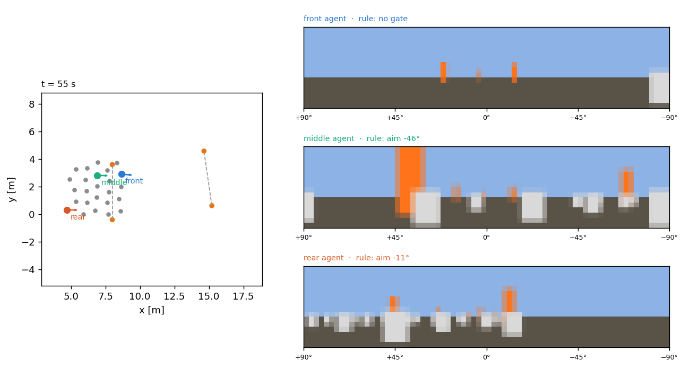

# vision-leaders

Gate perception from low-resolution cameras. Each agent of the
[`emergent_leaders`](../emergent_leaders/) swarm gets a forward camera, and a
small CNN maps its image to whether a gate is in view and the bearing to steer
along. The motion model, the leader bookkeeping and the gates are
`emergent_leaders`'; only the gate perception is replaced.

In `emergent_leaders` an agent becomes a gate leader when it senses a gate
post within 4 m in front of it, and aims at the gate centre (both posts
sensed) or at the lone post. Here the network decides both from the image.

## Camera (`camera.py`)

- 72 × 16 px, 8-bit RGB, 180° horizontal field of view; columns are equal
  steps in bearing (2.5° each), rows use the same angular step, heights
  project by perspective. The camera sits 0.2 m above the ground.
- Gate posts are orange cylinders, 1 m tall, of the motion model's post
  radius (0.15 m). Agents are grey cylinders, 0.25 m tall with radius 0.1 m
  (they are points in the motion model). Sky above the horizon, ground below.
- Pixels are area-sampled: an object fills the fraction of a pixel it covers,
  so a far post fades out instead of flickering. A post 4 m away is about
  2 px wide and 6 px tall.
- Objects are composited front to back, so nearer agents hide what is behind
  them. The posts stand above the agents, so their tops stay visible over the
  swarm. Rendering all 25 cameras takes about 6 ms per step.



## Teacher (`simulation.py`)

`VisionSimulation` renders every camera each step and computes the teacher's
gate perception alongside the network's:

- `teacher="full"` (default): the `emergent_leaders` rule with its perfect
  sensing within 4 m, whether or not the camera shows the posts. The network
  is trained on these labels.
- `teacher="camera"`: the same rule, but a post counts only if the camera
  shows at least half a pixel of it. This teacher fails at the gates: on the
  default slalom only 1 of 10 runs gets most of the swarm through all three
  gates (68% / 27% / 11% through), against 10 of 10 for the full rule. An
  agent passing between the posts sees only the post in front of it and turns
  into it. The full rule also senses the post behind, sees that the gate
  centre is behind, and stops aiming. With a 180° field of view this happens
  right at the gate; with 120° (the first design) it happens about 1 m before
  it, and the results were no better (1 of 10). Agents hiding the posts made
  no difference: the results were identical with invisible agents.

With the full teacher, the network has to learn from the image what the rule
senses directly, e.g. that a lone post close beside it means it is passing
through the gate.

## Network (`network.py`)

`GoalNet`: three 3 × 3 convolutions (16, 32, 32 channels, the last two with
stride 2), a 64-unit hidden layer, and three outputs: the logit of "gate
target" and the bearing as (sin, cos), relative to the heading, positive to
the left. A fourth input channel holds each column's bearing. An agent leads
when the probability reaches 0.5 and then aims along the predicted bearing.

With `goal_weighting="confidence"` (`--goal-weighting confidence`), the
probability q itself weights the goal term instead: every agent pulls along
its predicted bearing with γ = q, in f = αp + βh + Gγg. Agents with q ≥ 0.5
still count as leaders (spacing, statistics, video).

## Training (`train.py`)

1. **Behaviour cloning:** the full rule drives the swarm on 40 random courses
   (three-gate slaloms with 0–1.5 m offsets and four-gate winding courses with
   turns up to 45°, at the largest spacing the course rules allow), 300 s
   each. Every 20 steps (1 s) each agent's image is stored with the rule's
   label; images without a gate target are subsampled to 30%.
2. **DAgger:** three rounds of 20 runs in which the network drives; the rule
   labels the images it sees, they are added to the data, and the network is
   retrained on all of it.

Training on 22 CPU cores took 42 min.

## Results

`models/goalnet.pt` was trained as above. Offline, on a held-out 10% of all
images (most of them from DAgger rounds), it agrees with the rule on whether
to lead for 98.8% of images; on images where the rule leads, the bearing
error has a median of 1.8° and a 90th percentile of 5.3°. After behaviour
cloning alone, these were 98.3%, 2.5° and 9.7°.

Closed loop (`python -m vision_leaders.evaluate models/goalnet.pt`; explorers
off, `sigma_leader` 0.7, swarm facing the course):

| suite | perception | through each gate | runs with > 50% through all |
|---|---|---|---|
| default slalom, seeds 0–9, 320 s | rule | 92 / 90 / 81% | 10 / 10 |
| | network | 90 / 91 / 71% | 10 / 10 |
| winding, 7 m, seeds 0–19, 600 s | rule | 93 / 57 / 40 / 31 / 25% | 5 / 20 |
| | network | 91 / 61 / 40 / 28 / 24% | 4 / 20 |

The network drives about as well as the rule it imitates. On the winding
courses both lose the swarm at sharp turns (see the `emergent_leaders`
README), so the network isn't the limit there. The closed-loop effect of
DAgger was not measured separately: the behaviour-cloning model of this run
was overwritten (`train.py` now keeps each stage's model).

Confidence weighting (`python -m vision_leaders.evaluate models/goalnet.pt
--goal-weighting threshold confidence`) makes no clear difference:

| suite | goal weight | through each gate | runs with > 50% through all | agent-steps with 0.05 < q < 0.95 |
|---|---|---|---|---|
| default slalom | 1 if q ≥ 0.5 | 90 / 91 / 71% | 10 / 10 | 8.8% |
| | q | 91 / 91 / 76% | 10 / 10 | 8.0% |
| winding, 7 m | 1 if q ≥ 0.5 | 91 / 61 / 40 / 28 / 24% | 4 / 20 | 5.6% |
| | q | 91 / 58 / 39 / 23 / 15% | 3 / 20 | 6.3% |

The network is unsure for only 6–9% of agent-steps, so q mostly sits near 0
or 1 and both weightings act alike. It was trained on hard labels (would the
rule lead or not), so q estimates that probability; it says nothing about
how reliable the predicted bearing is.

Videos (agent 14's camera below the arena; network leaders are drawn as
gate-centre leaders, since the network doesn't say how many posts it sees):

- `videos/network_slalom.mp4`: default slalom, seed 0; 23 / 23 / 15 agents
  through.
- `videos/network_winding.mp4`: the winding course of
  `emergent_leaders/videos/gates_winding.mp4` (seed 5, 7 m); 24 / 20 / 22 /
  23 / 23 through, against 23 / 17 / 24 / 25 / 20 with the rule.

```sh
python -m vision_leaders.run --model models/goalnet.pt --gates 3 --seed 0 --duration 320 \
    --camera-agent 14 --video videos/network_slalom.mp4
python -m vision_leaders.run --model models/goalnet.pt --gates 5 --course winding --gate-spacing 7 \
    --seed 5 --duration 440 --camera-agent 14 --video videos/network_winding.mp4
```

## Usage

```sh
pip install -e ../emergent_leaders -e ".[dev]"

python -m vision_leaders.train --out models/goalnet.pt               # ~40 min on 22 cores
python -m vision_leaders.evaluate models/goalnet.pt                  # network vs rule
python -m vision_leaders.run --model models/goalnet.pt --gates 3 --seed 0 --video slalom.mp4
python -m vision_leaders.run --gates 3 --seed 0 --teacher camera     # camera-limited rule drives
```

`run.py` builds courses and starts like `emergent_leaders.run` (same seed,
same course). Its videos show the swarm and, below it, the camera of one
agent (`--camera-agent`, ringed in the arena) with the rule's bearing
(dashed) and the network's (solid).
